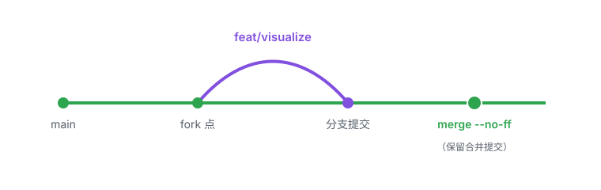

# hello-world

一个简单的 Hello World 示例，用来演示完整的 Git 工作流，并由 **华中科技大学数字社会研究中心** 署名维护。

## 可视化


> 上图由 `visualize.py` 生成（纯标准库，无第三方依赖），运行 `python visualize.py` 即可重新生成。

## 运行

```bash
python hello.py
```

输出：

```
Hello, World!
```

## 分支协作流（本版本的迭代方式）

本次 v0.2 的改动是在一条独立的功能分支 `feat/visualize` 上完成的，再合并回 `main`：



典型步骤：

1. `git checkout -b feat/visualize` —— 开一条短期功能分支
2. 在分支上改代码、`git add`、`git commit`（用 `feat:` 前缀）
3. `git checkout main` —— 切回主分支
4. `git merge --no-ff feat/visualize` —— 合并并保留一个合并提交，让历史清楚记录"这次特性何时合入"
5. `git branch -d feat/visualize` —— 合并后删除功能分支
6. `git push origin main` —— 同步到远程

## 项目结构

- `hello.py` —— 打印 `Hello, World!` 的程序
- `visualize.py` —— 生成可视化横幅（SVG）
- `hello_banner.svg` —— 可视化产物
- `branch_workflow.svg` —— 分支协作流程图
- `README.md` —— 本说明文件

## 版本历史

- **v0.2.0**（当前）：新增可视化横幅与分支协作流程图，更新 README，署名华中科技大学数字社会研究中心
- **v0.1.0**：初始化仓库，Hello World 程序 + 首次 README

## 这个仓库是怎么来的

它是一次 Git 工作流演示的产物，完整走过了这几步：

1. `git init -b main` —— 初始化仓库，默认分支 `main`
2. `git add hello.py` —— 把文件放入暂存区
3. `git commit` —— 生成一次提交（`feat: add hello world program`）
4. `git remote add origin <url>` —— 关联远程仓库
5. `git push -u origin main` —— 推送并建立起跟踪关系

之后每次改动，流程简化为：`add` → `commit` → `push`。

---

署名：华中科技大学数字社会研究中心
